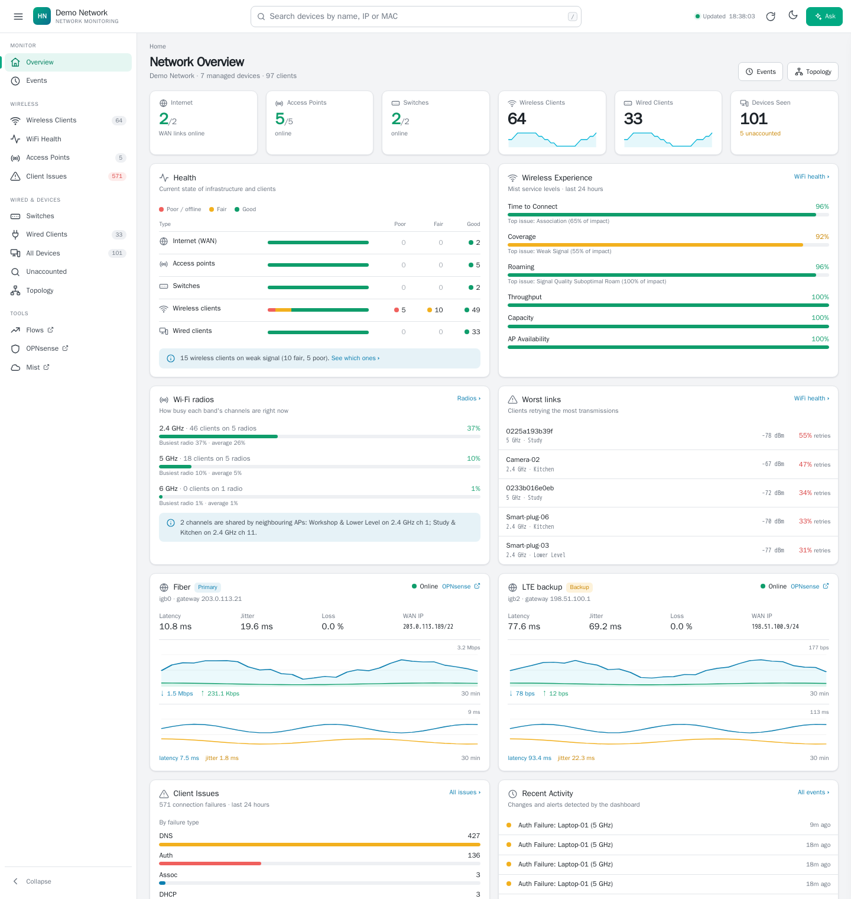
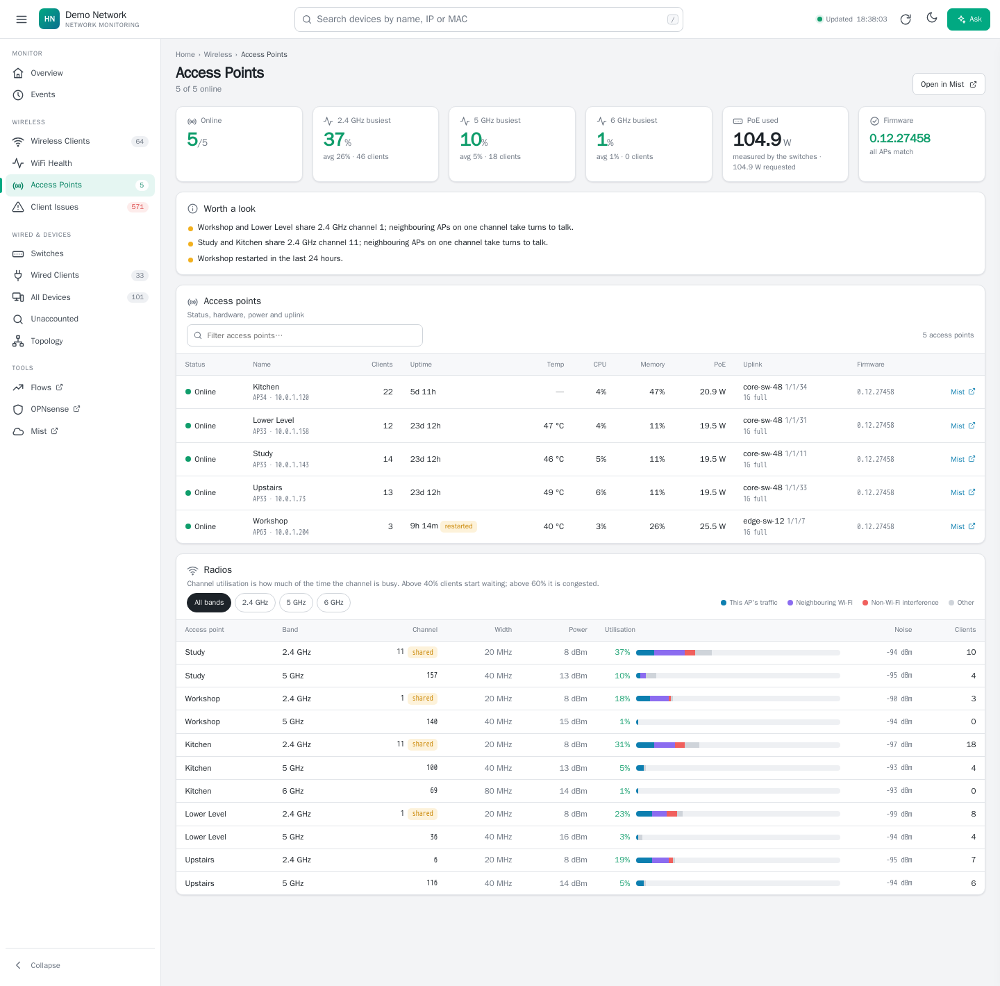
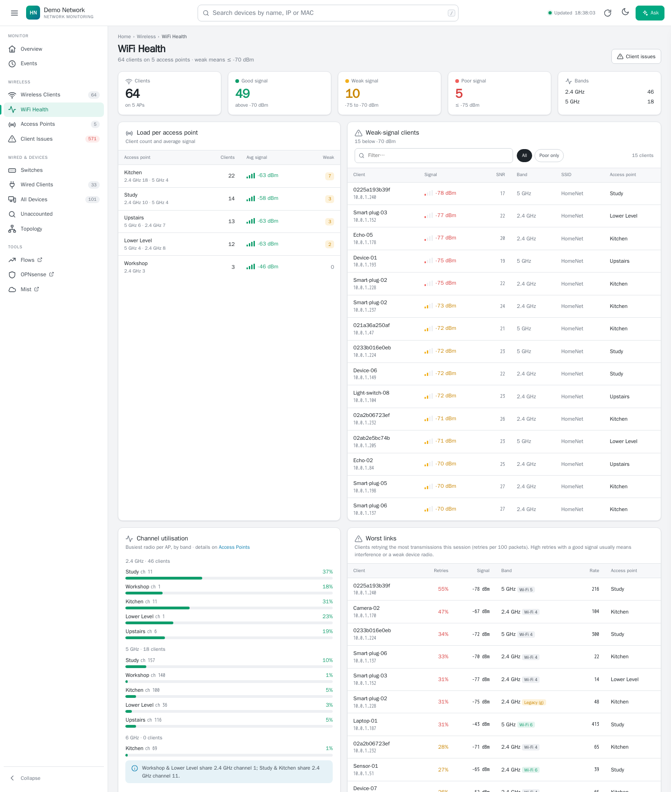
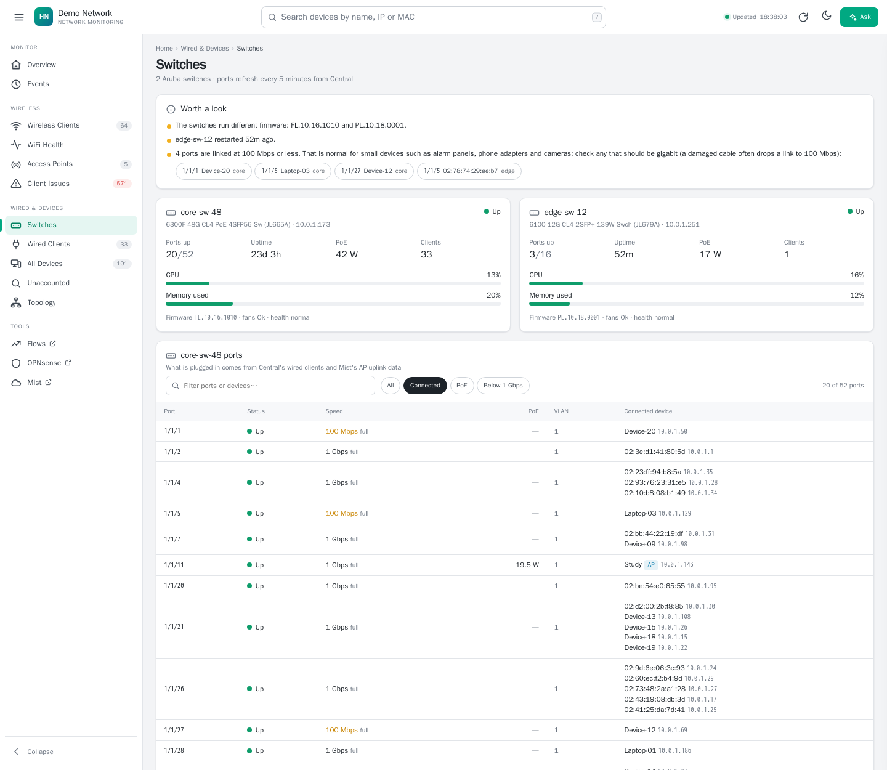
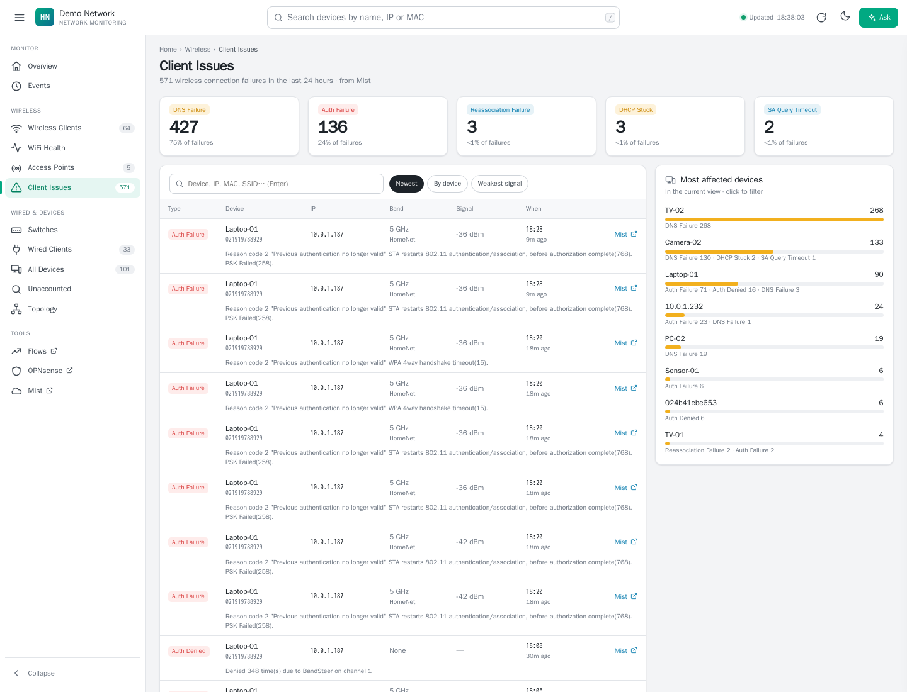
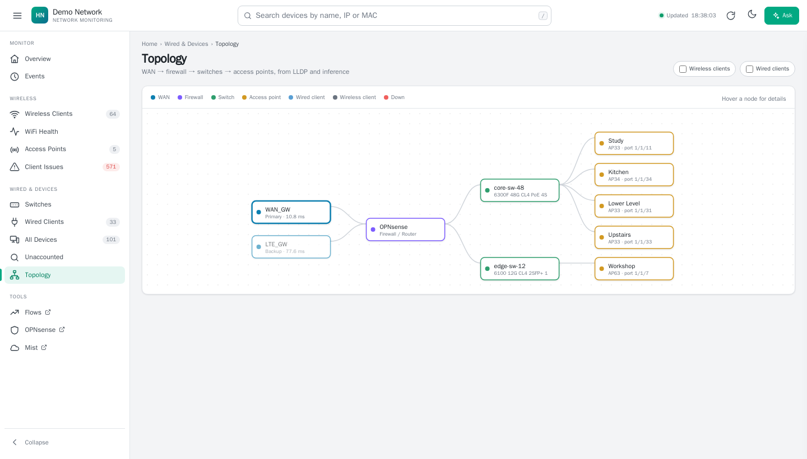
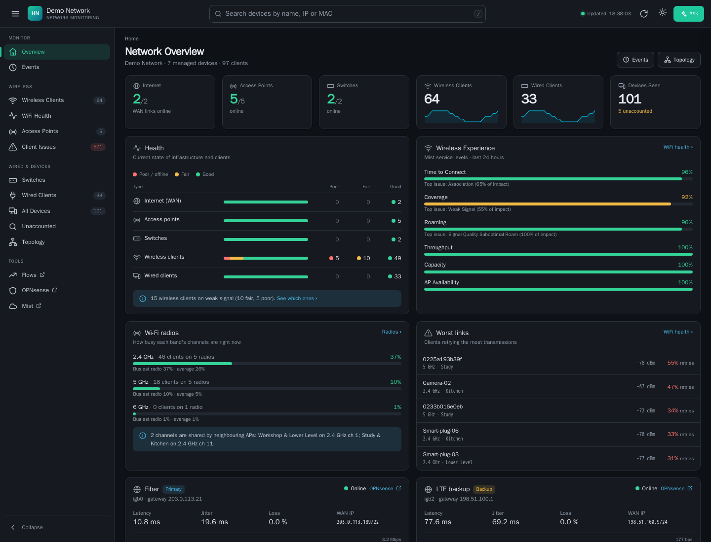
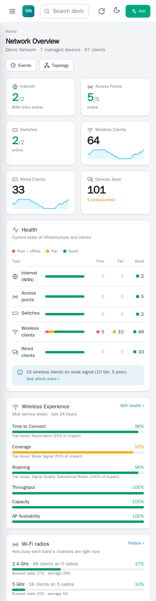

# Network dashboard

One place to see a home or small-office network: Wi-Fi from **Juniper Mist**,
switches from **HPE Aruba Central**, WAN links and DHCP from **OPNsense**, and every
device on the LAN from an **ARP scan**. Optional extras: flow data from
**ntopng**, sensors pushed to **Home Assistant**, and an **Ask** panel that
answers questions about the network using Claude.

It is a small Flask app that polls those APIs once a minute and serves the
pages below on port 5000. Each integration is optional; pages for the ones
you don't use are hidden.



<sub>Screenshots use anonymised demo data: names, addresses and MACs are made up.</sub>

| Page | What it shows |
|---|---|
| Overview | Health of internet, APs, switches and clients; Wi-Fi service levels; busiest radios; worst links; WAN latency and traffic; client issues; recent events |
| Events | Changes the dashboard noticed (WAN up/down, APs, switches, firewall services, firmware updates, new devices, Wi-Fi failures), filterable and paged |
| Firewall | OPNsense health (CPU, memory, disk, connections), firmware status, services, blocked traffic from the firewall log, and the busiest devices right now |
| Wireless Clients | Every Wi-Fi client with signal, retry rate, link rate, Wi-Fi generation and AP |
| WiFi Health | Signal quality, load per AP, channel utilisation, worst links, client mix |
| Access Points | AP health (uptime, temperature, CPU, memory, PoE, uplink, firmware) and every radio's channel, power and utilisation |
| Client Issues | Mist connection failures (DNS, DHCP, authentication…) by type and by device |
| Switches | Switch health and a port-by-port table showing what is plugged in where |
| Wired Clients | Wired clients by switch, port and VLAN |
| All Devices / Unaccounted | Everything the ARP scan finds, matched against Mist, Central and DHCP; devices no system accounts for |
| Topology | WAN → firewall → switches → APs (→ clients), from LLDP |
| Admin → Credentials | Replace any integration's API key or token from the browser (admin password required; keys are tested before saving and never shown) |

<details>
<summary><b>More screenshots</b></summary>

**Access points:** AP health and every radio's channel utilisation


**WiFi health:** channel utilisation, worst links and client mix


**Switches:** switch health and what is plugged into each port


**Client issues:** Mist connection failures by type and device


**Topology**


**Dark mode and phone view**

 

</details>

## Quick start

```bash
git clone <this repo> network-dashboard && cd network-dashboard/dashboard
python3 -m venv venv && venv/bin/pip install -r requirements.txt
cp config.example.yaml config.yaml          # then edit it
mkdir -m 700 secrets data                   # credential files go in secrets/
venv/bin/python3 app.py --check             # tests each integration you turned on
venv/bin/python3 app.py                     # http://<this machine>:5000
```

Full instructions: [docs/setup.md](docs/setup.md). Getting each API key:
[docs/integrations.md](docs/integrations.md). Every setting:
[docs/configuration.md](docs/configuration.md). Before exposing the dashboard
beyond your LAN, read [docs/security.md](docs/security.md).

## Layout

| Path | What it is |
|---|---|
| `dashboard/` | The app. `app.py` (polling, routes), `ui.py` (pages), `settings.py` (config loader), one module per data source or analysis. |
| `dashboard/config.example.yaml` | Annotated example configuration. Your own `config.yaml`, `secrets/` and `data/` are git-ignored. |
| `dashboard/systemd/` | Example service unit. |
| `ntopng/` | Optional ntopng + netflow2ng stack (Docker Compose) that turns NetFlow from OPNsense into flow data. |
| `docs/` | Setup, configuration, integrations and security. |
| `tools/`, `.githooks/` | Secret scanner and pre-commit hook. Run `git config core.hooksPath .githooks` once per clone. |

## Requirements

Linux with Python 3.10+, `arp-scan`, and network access to the APIs you use.
It runs comfortably on a small VM or container host.
